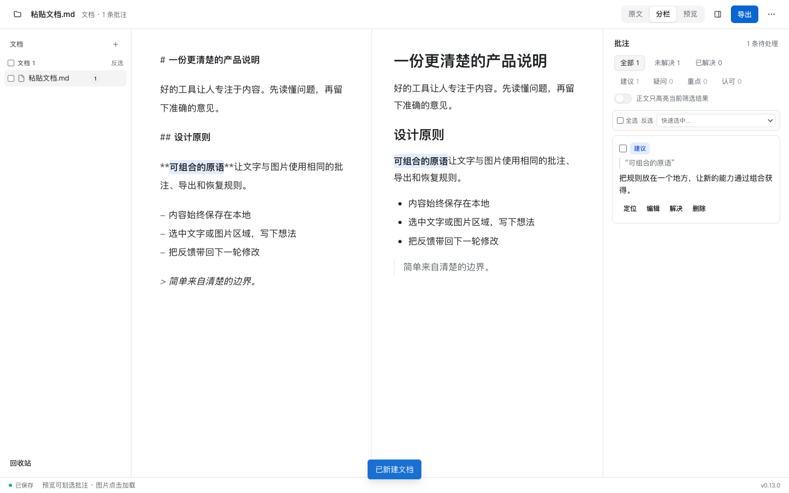
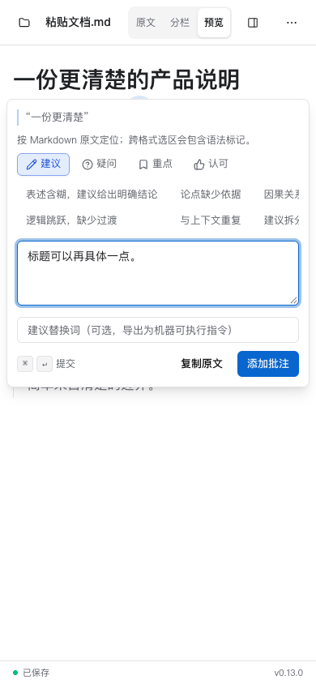
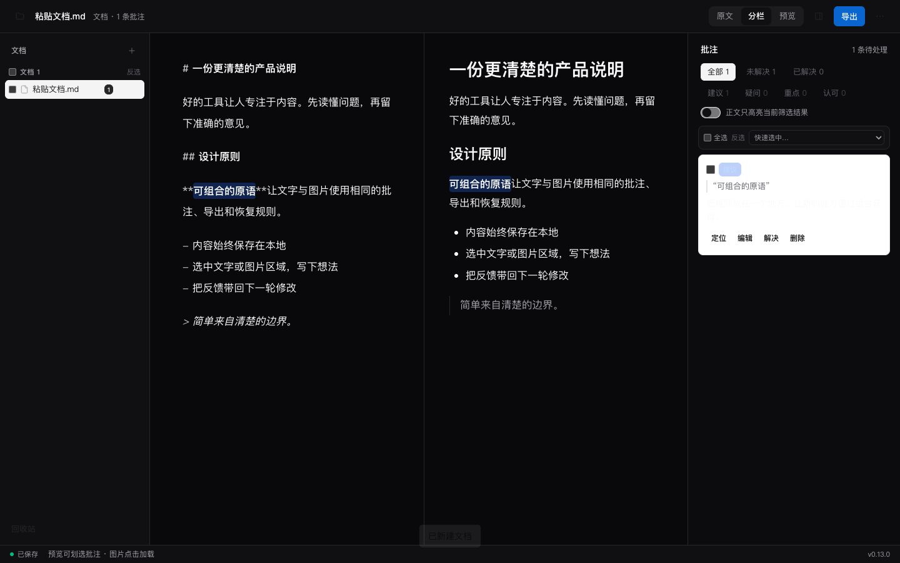

<div align="center">

English · [简体中文](README.md)

<picture>
  <source media="(prefers-color-scheme: dark)" srcset="https://signature4u.vercel.app/api/sign?text=InkMark&font=great-vibes&bg=transparent&fontSize=190&speed=1.4&fill=gradient&f1=e2e8f0&f2=7dd3fc" />
  
</picture>

**Inline annotation workbench** — annotate AI-revised text right where it hurts, and hand “what's wrong, and where” back to the AI.

[](https://github.com/YuniqueCore/inkmark/actions/workflows/deploy.yml)
[](https://github.com/YuniqueCore/inkmark/releases)


**[Open the app →](https://yuniquecore.github.io/inkmark/)**



| Mobile · composer (two-row chips, horizontal scroll) | Desktop · dark theme |
| --- | --- |
|  |  |

</div>

---

The UI follows the shadcn/ui design language (Tailwind CSS v4 + design tokens, inspired by rareui): neutral zinc base, hairline borders, subtle shadows, light & dark themes (toggle in the header, follows system preference, persisted in localStorage). It is a local-first frontend with no backend.

**Native applications (NSH)**: the shared workspace also has macOS / Windows / Linux hosts and Android / iOS embedding hosts. Web remains a pure static Pages build. See [native platform builds](docs/native-platforms.md) for artifacts, signing status, storage boundaries and local/CI tests.

## Features

- **Image region review**: paste screenshots, drop files or open PNG, JPEG and WebP images. Draw and adjust rectangles, enter exact pixel coordinates, zoom, pan with touch and use the existing sidebar actions. Limits: 12 MB, 32 million pixels and 16384 pixels per side. Review ZIPs include original bytes, feedback and a JSON copy filtered by the resolved toggle; image W3C uses FragmentSelector and requires the same image document. Rotation, polygons and EditHere smart selection are outside this feature.
- **Markdown source, split and preview**: Lezer highlights source syntax; split view shows the source and rendered Markdown side by side, or stacked when space is narrow. Both surfaces support selecting and annotating the same canonical source. Preview selections use parser source positions; a selection crossing formatting can include Markdown syntax in its source excerpt. Partial character entities and selections crossing hidden link destinations are rejected with guidance to use the source. Raw HTML is displayed as text, and remote images load only after a click.
- **Paste as a new document**: paste directly into an empty workspace or use “Import → Paste as new document.” Each action creates a separate document with a unique name. Empty input and pasted content over 400,000 UTF-16 units are rejected without discarding the input.
- **Select-to-annotate**: select text in the document → a pin pops up at the cursor → hover to expand the composer card → pick a kind (suggestion / question / highlight / praise) → tap quick-phrase chips (capped at two rows, horizontally scrollable) or just type, and optionally add a **suggested replacement** — even a plain selection can issue a machine-executable rewrite directive. Annotations stay on the text as colored highlights. **Draft protection** — stray clicks or the mouse wandering off never destroy what you're writing; drafts are keyed per passage and restored when you reselect (kind and replacement included). Esc inside the composer discards its draft; changing the text requires confirmation before discarding affected drafts. Cards and popups follow their anchor on scroll/resize, and scrolling inside the card never closes it.
- **Search & batch annotate (⌘F)**: a VSCode-style search panel — matches get outlined in the text live as you type (stacking with annotation backgrounds, WYSIWYG), Enter / ‹ › jump between hits, **Aa** toggles case sensitivity and **.\*** toggles regex matching (invalid regexes get a red hint); the panel embeds the same composer form as the pin card (**one component reused in three places**: pin card / search panel / popup edit mode). Pick a kind and quick phrases, optionally a **suggested replacement**, then annotate every occurrence of the same content in one click (with a cross-document toggle covering the whole workspace). The sidebar aggregates them into a single card (occurrence count + expandable per-occurrence edit / jump); resolve or delete the whole group at once. Replacements ride along the three text exports as machine-executable directives (`→ 替换为「…」`). The panel never re-renders its own nodes on input, so IME composition is never interrupted.
- **Edit the source + robust anchoring**: edit the canonical text in place; afterwards every annotation re-anchors automatically via **multi-strategy matching** (position-hint scoring + prefix/suffix weighted disambiguation + edit-distance fuzzy re-anchoring for lightly edited quotes — ported from Hypothesis's production anchoring, plus a quote-length-graded confidence gate so a short quote whose context changed is marked lost instead of mis-anchored elsewhere). Quotes that can't be matched are clamped onto the real edit point via a **character-level diff**. Annotations are never lost to edits; lost anchors get a visible marker (amber squiggle in the text, a “lost anchor” badge in the sidebar/popup) that clears itself once the quote returns.
- **Source editing**: unchanged text keeps its original line endings; edits preserve a uniform line-ending style and ask before normalizing mixed endings to LF.
- **Diff view**: paste the AI's revision to get a line-level track-changes diff (Myers algorithm, graceful degradation for huge edits); **both sides are annotatable** — source-side annotations pin to modified lines, revision-side annotations pin to added lines (tagged in the sidebar), and clearing the revision cleans up after itself.
- **Three export formats** (header button or ⌘/Ctrl+S): every annotation carries `@start-end` UTF-16 offsets (0-based, end-exclusive; W3C JSON position selectors are converted to Unicode code points) so machines can locate it precisely; download filenames are prefixed with the source document name (`chapter-3-批注-snippets-2026-09-28.md`):
  1. **Source + annotations**: full text with inline `【批注①·…】` markers inserted at each anchor;
  2. **Snippets + annotations**: each annotated passage listed with its annotations;
  3. **Review block**: Markdown quote format, paste it straight back to your AI agent.
  Copy or download as .md; resolved annotations are excluded by default (opt-in); a “file info” switch stamps the source file name on top — handy with multiple documents (W3C JSON stays standards-compliant).
- **Folder import + conflict treeview**: with an empty workspace, imports go straight in; otherwise same-name conflicts (relative path + file name) open a **diagnostic treeview** first — decide per file "overwrite / rename / skip", or use the bulk presets (**overwrite all / overwrite un-annotated / overwrite annotated**); renames increment before the extension (`chapter-1-1.txt`), identical content is flagged "no change" and skipped, and cancelling voids the whole import. **Overwriting never destroys annotations**: existing annotations re-anchor onto the new text through the same pipeline as source editing, with a re-anchor / lost-anchor preview per row before you confirm. Single-file imports run the same diagnosis — no second code path.
- **Selected annotation export**: text and image reviews share sidebar selection. Bulk operations apply to visible annotations; changing filters removes hidden selections. Selected export includes exactly that scope, including the JSON inside image review ZIPs. Keyboard selection retains focus.
- **W3C Web Annotation import / export**: export annotations as standard Annotation JSON (TextQuoteSelector + TextPositionSelector); on import, quotes are re-anchored automatically (position mismatch → full-text search → prefix/suffix disambiguation) and anything that can't be anchored is skipped explicitly — never mis-anchored. Opening a .json file imports it.
- **Slop pre-scan**: ships with the [anti-slop-kit](https://github.com/YuniqueCore/natural-talk) lexicons (169 zh / 212 en entries); one click marks boilerplate candidates with red squiggles and prefills annotations for human review. The pipeline mirrors `slop_check.py`: protected regions (code fences / inline code / URLs / emails), regex flags, overlap dedupe before cluster/density escalation; **identical scoring** (w / cluster_w / density_w weights, score = evidence weight per kilo-unit, clean / light / noticeable / heavy); **score history** persists per document (last 20 samples) with deltas and a mini trend line in the stats card.
- **Document tree with bulk actions**: multi-select documents (select all / **invert selection**), bulk export (pick a format once → copy everything or download a zip, duplicate names auto-numbered) or bulk delete (with confirmation); each tree row also has a hover export button, so you never need to switch documents just to export.
- **Annotation management**: sidebar list with kind/status filters (**kind chips share the composer's list — the four manual kinds stay visible, machine kinds like issue / AI-slop appear only when present**; the canonical list lives in core `ALL_KINDS`), locate / edit / resolve / delete, and confirmation on every destructive action. **Multi-select bulk actions**: a checkbox surfaces on each card on hover (stays visible once something is selected), with select all / **invert** / a **quick-select** dropdown (lost-anchor / unresolved / resolved / revised-side / by kind); bulk resolve & delete (with confirmation) get toast feedback and a slide-in action cluster; "highlight filtered annotations only" is a toggle switch. After a scan, the sidebar shows a **slop score card**: band badge (clean / light / noticeable / heavy) + score per kilo-unit + category distribution, invalidated and re-scanned when the text changes.
- **Responsive layout**: three-pane desktop at ≥lg (drag to resize); below lg, single pane with left/right **drawers** (document tree / annotation list slide over, dismissed by backdrop or Esc); the header condenses to icons on small screens; composer, popups and the export modal are all clamped inside the viewport, with dvh heights for mobile browser chrome. `public/device-test.html` is a self-check page that runs scripted assertions at three real device sizes.
- **Autosave and backups**: atomic IndexedDB snapshots retain original images and trash. “Saved” means the transaction completed. Concurrent tabs detect divergent writes and retain unsaved work for a complete recovery download. More → Download complete workspace backup includes trash and can be restored with the dedicated replacement action; document-only backups remain mergeable imports. Neither backup includes unsubmitted drafts. Legacy localStorage data is retained with a separate download action, so an older tab cannot lose its updates during migration. It remains readable and exportable when IndexedDB is unavailable. Unreadable data is also preserved.
- **Reading preferences (settings + floating hub)**: five themes — light / **sepia** (warm paper)/ dark / **panda** (dark sidebars, light content)/ **panda-inverse** (light sidebars, dark content), each rendered in Settings as a **mini preview** painted with the real theme tokens; four background **textures** (paper grain / grid / ruled lines / linen, inspired by e-readers); body font (default / serif / kai / mono) and a **font size** slider (13–22px, line height scales along). A **floating hub** sits in the bottom-right of the content pane: 40% opacity at rest, fully opaque on hover, expanding along a **quarter-circle arc** to theme / texture / size / font (hover again for flyout options or a slider; tap-friendly), plus a "All settings" item opening the full dialog; the header toggle flips polarity within the current theme family. Everything applies instantly, persists to localStorage, and is applied by an inline first-paint script with no flash.

## Quick start

Development and tests require Bun and Node.js 24 (or another version allowed by `engines` in package.json).

```bash
git clone --recurse-submodules https://github.com/YuniqueCore/inkmark.git
bun install        # or npm install
bun run dev        # dev server
bun run build      # typecheck + build to dist/
bun run test       # vitest unit tests (pure core + component logic)
bun run test:e2e   # Playwright screenplay browser suite (uses system Chrome)
```

> The lexicons come from the [natural-talk](https://github.com/YuniqueCore/natural-talk) submodule (`skill/`) — clone with `--recurse-submodules`, or run `git submodule update --init` in an existing checkout.

## Testing

Two layers, each with a clear job:

- **vitest (tests/)**: pure core functions and component logic (draft ledger, IME guards, export / import / re-anchoring).
- **Playwright screenplay (e2e/)**: real browser behavior, layered after the Screenplay pattern —
  `abilities/` (drive the page) → `screens/` (semantic locator contracts) → `interactions/` (atomic actions) →
  `tasks/` (business workflows) → `questions/` (read-only state queries); assertions live only in `e2e/specs/`.
  Key coverage: composer-card stability while operating its own controls (scrolling chips, typing, blur),
  the annotation popup, source/preview mappings, paste and recovery, storage errors, import races, structural and visual snapshots, and mobile drawers.

## Structure

```
src/
  core/          pure-function core, DOM-free, fully testable
    types.ts     domain types (annotations, lexicon schema)
    text.ts      canonical text blocks, snippets, W3C TextQuoteSelector
    anchors.ts   annotation ranges → render segments (scanline)
    export.ts    the three export formats
    diff.ts      line-level Myers diff (revision view)
    reanchor.ts  re-anchoring after source edits (multi-strategy quote anchoring + char-diff clamp fallback)
    quote-match.ts  quote matching (exact/fuzzy candidates + context-weighted scoring + confidence gate)
    w3c.ts       W3C Web Annotation import / export with robust re-anchoring
    import.ts    import pipeline (text / session / W3C classification)
    import-conflict.ts  import-conflict plan (treeview / renames / bulk presets)
    prefs.ts     reading-preferences model (theme / texture / font / size)
    slop.ts      lexicon scan: protected regions / dedupe / cluster / density
  ui/            DOM layer (editor / markdown-preview / markdown-syntax / selection / sidebar / exporter / storage)
  skill/         natural-talk submodule — single source of truth for lexicons:
                 skill/references/anti-slop-kit/scripts/data/{zh,en}.json
tests/           vitest specs
e2e/             Playwright screenplay suite (abilities/tasks/questions/specs)
```

Design constraint: content, selectors and annotation bodies have separate responsibilities. Text uses UTF-16 ranges; images use natural pixel rectangles. The shared sidebar consumes a presentation projection, while text analysis only accepts text documents. Core remains DOM-free and IndexedDB is the workspace storage boundary. See [image review architecture](docs/image-review.md).

## Known limits & roadmap

- [ ] Export a standalone diff review report for the revision view (revision-side annotations currently fold into the three export formats with a “revised” tag)

---

<div align="center">

The header signature is generated on the fly by [animated-sign-4u](https://github.com/YuniqueUnic/animated-sign-4u)’s `/api/sign` endpoint (animated SVG · transparent background · light/dark palettes).
To make your own, open the editor with `?bg=transparent` → **[signature4u.vercel.app/editor](https://signature4u.vercel.app/editor?bg=transparent)**

</div>
