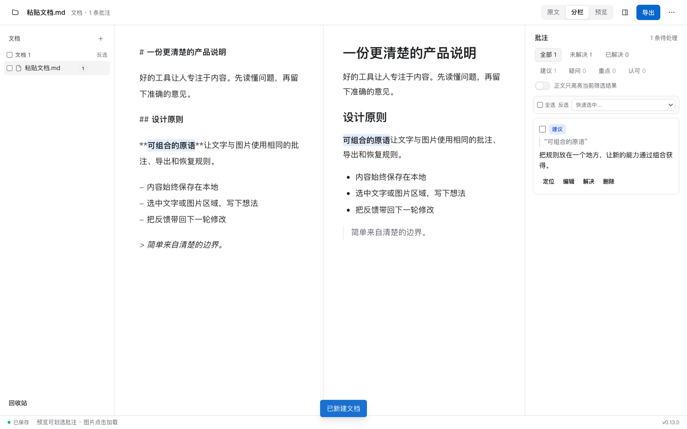
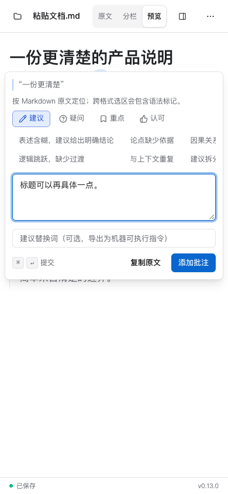
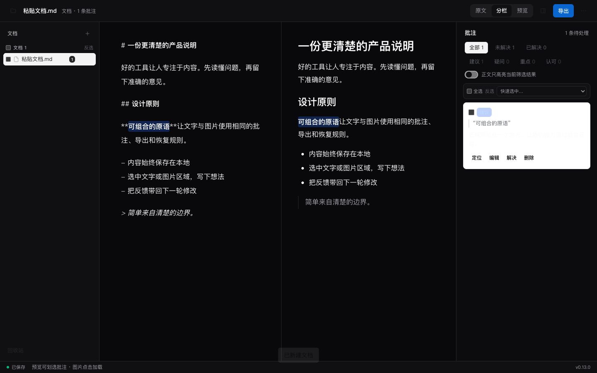

<div align="center">

[English](README.en.md) · 简体中文

<picture>
  <source media="(prefers-color-scheme: dark)" srcset="https://signature4u.vercel.app/api/sign?text=InkMark&font=great-vibes&bg=transparent&fontSize=190&speed=1.4&fill=gradient&f1=e2e8f0&f2=7dd3fc" />
  
</picture>

**文字与图片批注工作台** —— 对文本划词、对截图框选，保留准确位置和修改意见，递回给 AI。

[](https://github.com/YuniqueCore/inkmark/actions/workflows/deploy.yml)
[](https://github.com/YuniqueCore/inkmark/releases)

**[在线使用 →](https://yuniquecore.github.io/inkmark/)**



| 手机 · 撰写卡（快捷语两行封顶、横向滚动） | 桌面 · 暗色主题 |
| --- | --- |
|  |  |

</div>

---

UI 按 shadcn/ui 语系构建（Tailwind CSS v4 + 设计 token，灵感来自 rareui）：中性 zinc 底、细边框、subtle 阴影、明暗双主题（顶栏切换，跟随系统偏好，localStorage 记忆）。纯前端、零后端。

**原生应用（NSH）**：同一工作台现提供 macOS / Windows / Linux 桌面宿主与 Android / iOS 嵌入宿主；Web 继续作为纯静态 Pages 构建。构建产物、签名状态、存储边界与本地/CI 测试命令见 [跨平台构建说明](docs/native-platforms.md)。

## 功能

- **图片区域批注**：直接粘贴截图、拖入或打开 PNG / JPEG / WebP；框选、移动、调整边界、数值坐标输入与触屏平移，共用右侧类型/状态/删除恢复流程。单图上限 12 MB、3200 万像素、最长边 16384 px。评审 ZIP 包含原图、坐标意见和按当前筛选导出的 JSON；W3C 使用 `FragmentSelector`，只导回同一图片文档。旋转、多边形和 EditHere 的智能选块不在当前范围内。
- **Markdown 原文 / 分栏 / 预览**：原文用 Lezer 语法范围着色；分栏同时显示原文与渲染结果，窄区域上下排列。两个视图都可划选、撰写和查看同一批注。预览选区通过解析器的源位置映射到规范 Markdown；跨格式的源摘录可能包含语法标记。无法精确映射的局部实体或跨隐藏链接地址选区会提示改在原文中选择。原始 HTML 以文本显示，外部图片需点击后才加载。
- **粘贴新建文档**：空工作台可直接粘贴，也可从「导入 → 粘贴新建文档」输入文本；每次创建独立文档，自动分配不冲突名称，保留现有文档和批注。空内容和超过 400,000 UTF-16 单元的粘贴会被拒绝并保留输入。
- **划词批注**：选中正文文字 → 停点浮出标注小点 → hover 展开撰写卡片 → 选类型（建议 / 疑问 / 重点 / 认可）→ 快捷批注语 chips（两行封顶、横向滚动）或直接输入，还可选填「建议替换词」，划词也能直接下达机器可执行的改写指令。批注以彩色高亮留在原文上；**草稿保护**——输入中鼠标滑出 / 误点外部不丢稿，草稿按段落记账、重选即取回（含类型与替换词；撰写卡内按 Esc 可取消，修改原文前会确认是否放弃受影响草稿），卡片与弹层滚动缩放跟随锚点，卡内滚动不误关。
- **搜索与批量批注（⌘F）**：VSCode 式搜索面板——输入即在正文实时描边命中（与批注底色叠加，所见即所得），Enter / ‹ › 在命中间跳转，**Aa** 切换大小写敏感、**.\*** 切换正则匹配（非法正则描红提示）；面板内嵌与划词卡同款的撰写表单（**一套组件三处复用**：划词卡 / 搜索面板 / 批注弹层编辑态），选类型、点快捷语、可选填「建议替换词」，一键给 N 处相同内容写同一条批注（可勾选跨文档，跨工作区所有文档生效）。侧栏聚合成一张卡（N 处统计 + 展开逐条编辑 / 跳转），整组一键解决 / 删除。替换词随三种导出生成机器可执行指令（`→ 替换为「…」`）。面板输入全程定向更新、不重绘节点，输入法组合不被打断。
- **编辑原文 + robust anchoring**：直接修改规范文本，完成后批注按引文自动重锚——**多策略锚定**（位置提示评分 + prefix/suffix 上下文加权消歧 + 引文被小改时按编辑距离模糊回锚，参考 Hypothesis 生产锚定并加按引文长度分级的置信度门控：短引文上下文已变宁可失锚也不错锚到别处），改不掉的经**字符级 diff** 钳到真实改动点，批注永不因编辑丢失；失锚批注带可见标记（正文琥珀色波浪线 + 侧栏/弹层「失锚」徽标），引文改回来时自动清除。编辑保留原有统一换行格式；混合换行的修改在保存前提示会统一为 LF。
- **对照视图**：贴入 AI 改稿，生成原文 vs 改稿的行级 track-changes diff（Myers 算法，超大改动自动降级）；**两侧都可划选写批注**——原文侧批注钉在被改动的行上，改稿侧批注钉在新增行上（侧栏带「改稿」标记），清除改稿时一并处理。
- **三种导出**（顶栏「导出」或 ⌘/Ctrl+S）：每条批注都带 `@start-end` UTF-16 偏移（0-based、右端开区间；W3C JSON 的位置选择器按 Unicode code point 转换），机器可精确定位；下载文件名以来源文档名打头（`chapter-3-批注-snippets-2026-09-28.md`），多份文档的批注文件不再混淆：
  1. **原文 + 批注**：完整原文，批注以 `【批注①·问题】……` 行内标记插在锚点后；
  2. **片段 + 批注**：逐条列出被批注的片段和对应批注；
  3. **评审引用块**：Markdown 引用格式，直接贴回聊天窗口给 AI agent。
  支持复制与下载 .md；默认不含已解决批注（可勾选包含）；「包含文件信息」开关在导出顶部标注来源文件名，多文档场景区分出处（W3C JSON 保持标准格式不受影响）。
- **克制的工作台**：顶栏保留文档导航、源码 / 分栏 / 预览、批注栏与导出。导入和新建放在文档区；搜索、原文编辑、改稿对照、阅读设置与备份放在可点击、可键盘操作的菜单。桌面／移动原生应用使用 NSH 原生导航、列表、输入框和弹窗，WebView 仅承载文档与图片画布。
- **文件夹导入 + 冲突诊断树**：工作区为空时直接导入；已有文档时，同名冲突（相对路径 + 文件名）先弹**诊断树**——逐行决策「覆盖 / 重命名 / 跳过」，或用批量预设（**全部覆盖 / 覆盖未标注的 / 覆盖标注的**）；重命名插扩展名前递增（`chapter-1-1.txt`），同名同文标「无变化」跳过，取消则整次作废。**覆盖不毁批注**：原有批注按「编辑原文」同款管线重锚到新文本，弹层内预演预告重锚 / 失锚条数，先知情再确认。单文件导入走同一套诊断，无双轨逻辑。
- **W3C Web Annotation 导入 / 导出**：批注可导出为标准 Annotation JSON（TextQuoteSelector + TextPositionSelector 双选择器）；导入时自动按 quote 在目标文本里重锚（位置失配 → 全文搜索 → prefix/suffix 消歧），锚不上的明确跳过、绝不错。打开 .json 文件即可导入。
- **slop 预扫描**：内置 [anti-slop-kit](https://github.com/YuniqueCore/natural-talk) 的中英文词库（zh 169 条 / en 212 条），一键把套话候选标成红色波浪线预填批注，人工复核后解决或删除。扫描管线与 `slop_check.py` 完全对齐：代码围栏 / 行内代码 / URL / 邮箱保护、正则 flags、重叠去重先于 cluster/density 阈值升级；**评分分档同源**（w / cluster_w / density_w 权重，score = 证据权重 / 千单位，clean / light / noticeable / heavy）；**评分历史**随文档持久化（最近 20 次采样），统计卡展示环比升降与迷你趋势线。
- **文档树多选批量操作**：树内每份文档可勾选（原生端先进入“选择文档”，支持全选 / **反选**），批量导出（评审按文档打包 ZIP，W3C 为单份合并 JSON，同名文件自动加序号）或批量删除（二次确认）；每个条目还有单项导出入口，无需切换文档即可导出。
- **选中批注导出**：文字与图片共用侧栏多选。全选、反选和批量操作只作用于当前可见批注；切换筛选会移除隐藏选择。选中导出只包含这些批注，ZIP 内 JSON 同步遵守选择与状态范围。键盘勾选保留焦点。
- **批注管理**：侧栏列表，按类型与状态筛选（类型 chips 与撰写卡同一套清单——人工四类常驻，问题 / AI 味等机器类型存在时才追加，单一来源在 core `ALL_KINDS`），定位 / 编辑 / 解决 / 删除，全部破坏性操作二次确认。**卡片多选批量操作**：每张卡提供可键盘操作的勾选框，支持全选 / **反选** / **快速选中** selector（失锚 / 未解决 / 已解决 / 改稿侧 / 按类型），批量解决与删除（二次确认）带 toast 反馈与滑入动画；「正文只高亮当前筛选结果」为开关 toggle。扫描后侧栏顶部展示 **slop 评分统计卡**：分档徽标（干净 / 轻微 / 明显 / 严重）+ 每千单位评分 + 类目分布，文本编辑即失效重扫。
- **回收站（批注 + 整文档）**：删除不再直接消失——批注与整文档删除后进入回收站，**保留 7 天**、过期自动清理；当前页面里仍有未提交划词草稿的文档会暂缓清理。选中含**失锚批注**时删除弹层给出「标记为已解决」引导（失锚批语仍完整，归档优于删除）。回收站弹层支持**搜索**（匹配批语 / 出处文档 / 类型）、**多选批量**（全选仅作用于当前筛选结果，批量恢复 / 批量彻底删除均二次确认）、单条恢复与彻底删除；**整文档入站**恢复即连文档带批注找回，原文档已删除的批注条目明确提示不可恢复。会话格式 v3，旧会话自动迁移。
- **响应式布局**：桌面三栏可调宽，顶栏按钮控制文档与批注栏；窄窗口使用覆盖式面板，移动端使用底部原生抽屉。窗口宽度决定布局，设备平台决定控件尺寸；表单适应键盘和视口，重要操作不依赖悬停。
- **自动保存与备份**：工作区以完整快照保存在 IndexedDB，保存完成后才显示“已保存”；多标签页出现实际冲突时保留本页内容并提示备份。更多菜单的“下载完整工作区备份”包含原图与回收站，可用“恢复完整工作区备份”替换恢复；“下载文档与批注备份”用于合并导入，排除回收站。两种备份均不含未提交草稿。旧 localStorage 数据始终保留，并提供单独下载入口，避免仍开的旧标签页更新被迁移覆盖；IndexedDB 不可用时仍可读取和备份旧数据。无法解析的数据也保留供下载。
- **阅读偏好**：集中在阅读设置中，支持十二套主题（含两种熊猫主题）、十种纹理、八种字体、四档字重和 13–22px 字号。自定义正文／背景颜色自动校正文字对比度至 WCAG AA；全部偏好即时生效并保存在 localStorage。正文保留阅读主题，应用导航维持中性层级。

## 快速开始

开发与测试需要 Bun 和 Node.js 24（或 package.json `engines` 中列出的兼容版本）。

```bash
git clone --recurse-submodules https://github.com/YuniqueCore/inkmark.git
bun install        # 或 npm install
bun run dev        # 开发
bun run build      # 类型检查 + 构建到 dist/
bun run test       # vitest 单测（core 纯函数 + 组件逻辑）
bun run test:e2e   # Playwright screenplay 浏览器套件（用系统 Chrome）
```

> 词库来自 [natural-talk](https://github.com/YuniqueCore/natural-talk) 子模块（`skill/`），克隆时需要 `--recurse-submodules`；已克隆的仓库用 `git submodule update --init` 补齐。

## 测试

双层测试，各司其职：

- **vitest（tests/、src/tests/）**：core 纯函数与组件逻辑（草稿记账、IME 守卫、导出 / 导入 / 重锚）。
- **Playwright screenplay（e2e/）**：真实浏览器行为，按 Screenplay 模式分层——
  `abilities/`（驾驶页面）→ `screens/`（语义定位器契约）→ `interactions/`（原子操作）→
  `tasks/`（业务工作流）→ `questions/`（只读状态查询），断言只出现在 `e2e/specs/`。
  重点覆盖：撰写卡在操作内部控件（横滚快捷语、输入、失焦）时的稳定性、
  批注弹层编辑态、双视图映射、粘贴与恢复、存储错误、导入竞态、结构与视觉快照、手机视口抽屉互斥。

- **NSH 原生测试**：直接点击原生工具栏、输入框和菜单，结合真实 WebView 验证导入、CRLF 原文编辑、预览批注、关闭保护、失败重试及图片坐标；Android instrumentation 与 iOS XCUITest 操作安装后的原生应用。构建与验证范围见 [跨平台说明](docs/native-platforms.md)。

## 结构

```
src/
  core/          纯函数核心，不依赖 DOM，全部可测
    types.ts     领域类型（批注、词库 schema）
    text.ts      规范文本分块、摘录、W3C TextQuoteSelector
    anchors.ts   批注范围 → 渲染分段（扫描线）
    export.ts    三种导出格式
    diff.ts      行级 Myers diff（对照视图）
    reanchor.ts  编辑原文后的批注重锚（引文多策略锚定 + 字符级 diff 钳制兜底）
    quote-match.ts  引文锚定匹配（精确/模糊候选 + 上下文加权评分 + 置信度门控）
    w3c.ts       W3C Web Annotation 导入 / 导出与 robust 重锚
    import.ts    导入管线（文本 / 会话 / W3C 分类解析）
    import-conflict.ts  导入冲突判定与计划（诊断树 / 重命名 / 批量预设）
    prefs.ts     阅读偏好模型（主题 / 纹理 / 字体 / 字号，归一化与极性翻转）
    slop.ts      词库扫描：保护区掩码 / 去重 / cluster / density
  workbench/     工作区命令与共享展示模型（文档、批注、搜索、草稿、回收站）
  platform/      文件边界与原生展示协议（session / request / interaction）
  ui/            Web 控件与共享文档画布（Markdown / selection / image / storage）
  styles/        Web 应用与共享画布的独立样式入口
native/shared/   NSH 原生导航、列表、表单与生命周期门禁
src/tests/       新增纯核心及原生展示协议测试
  skill/         natural-talk 子模块——词库单一来源：
                 skill/references/anti-slop-kit/scripts/data/{zh,en}.json
tests/           vitest 正反例
e2e/             Playwright screenplay 浏览器套件（abilities/tasks/questions/specs）
```

设计约束：文档内容、定位选择器与批注正文分开建模；文字使用 UTF-16 范围，图片使用自然像素矩形。侧栏接收统一展示投影，文本分析只处理文本；core 不依赖 DOM，IndexedDB 是工作区存储边界。详见 [图片批注与存储设计](docs/image-review.md)。

## 已知边界与路线图

- [ ] 对照视图导出独立的 diff 评审报告（当前改稿侧批注并入三种导出并带「改稿」标记）

---

<div align="center">

页首签名由 [animated-sign-4u](https://github.com/YuniqueUnic/animated-sign-4u) 的 `/api/sign` 接口实时生成（动画 SVG · 透明底 · 明暗双配色），
在编辑器里用 `?bg=transparent` 可以自己调一份 → **[signature4u.vercel.app/editor](https://signature4u.vercel.app/editor?bg=transparent)**

</div>
